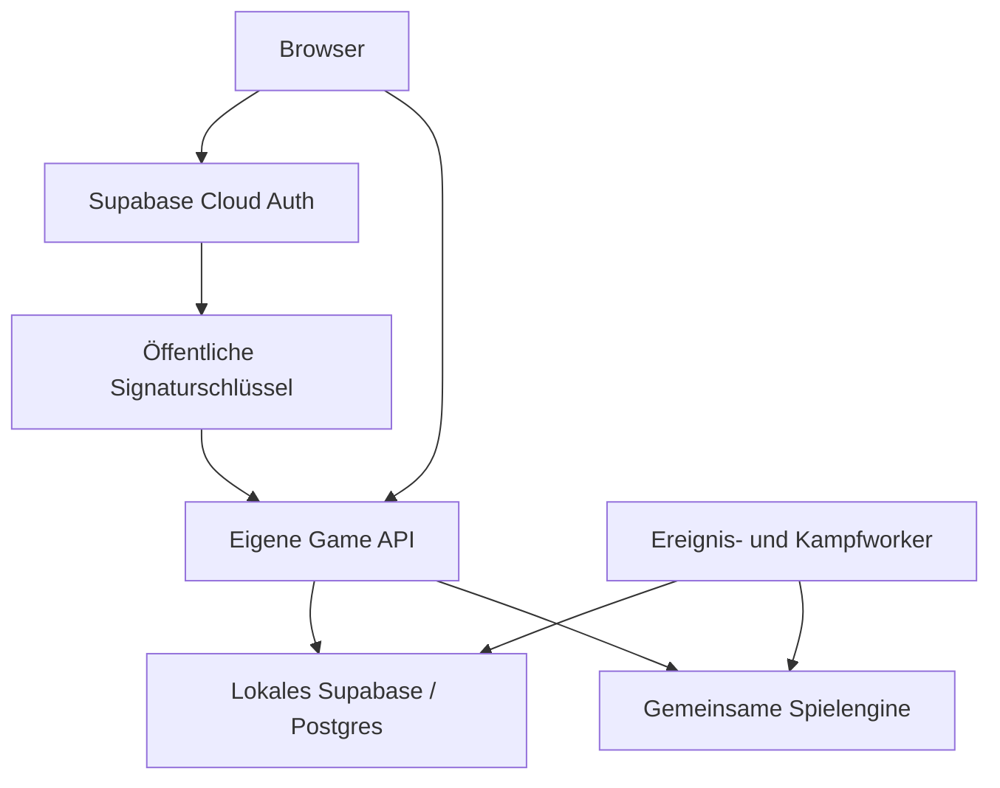

# WaHueLaPa Universe: Mehrspielerbetrieb und eigener Server

Stand: 25.10.2026. Geprüfter Ausgangscommit: `1ff9794271fb6a153c2eadf1d7acaf5354ba0ee6`.
Live-Projekt: Wahuelapa; PostgreSQL 17.11; aktive Edge Function `swift-handler`, Version 45.
Das abgerufene Live-Bundle entspricht nach Entfernung äußerer Leerzeichen dem Dashboard-Bundle im Repository. Keine Produktionsdaten, SQL-Funktionen oder Deployments wurden verändert.

## Entscheidung

Die Hauptursache für die schlechte Skalierung ist der globale Verarbeitungspfad. Ein normaler Abgleich lädt die gesamte Welt, verarbeitet sie und versucht sie gemeinsam zu speichern. Kämpfe verschärfen das Problem; sie sind nicht die einzige Ursache. Mehr Hardware oder mehrere Edge-Endpunkte mit demselben globalen Commit lösen diese Kopplung nicht.

Empfehlung: zunächst messen und den bestehenden Pfad entlasten, anschließend eigene Spieleraktionen von gemeinsamen Ereignissen trennen, danach Kämpfe in dauerhafte Jobs auslagern. Den Umzug auf den eigenen Server erst mit getesteter Datenmigration und Rückfallplan durchführen. Es gibt keine seriöse Garantie für „nie wieder Serverprobleme“; das Ziel sind messbare Kapazität, Fehlerisolation und Wiederherstellbarkeit.

## Was heute tatsächlich passiert

| Bereich | Aktueller Ablauf | Auswirkung |
|---|---|---|
| Browser | `engine.js` berechnet Anzeige/Prognosen; `cloud.js` sendet autoritative Aktionen | Gemeinsame Engine ist eine gute Grundlage für Wiederverwendung |
| Abgleich | Normal 30 Sekunden, bei ein-/ausgehenden PvP-Flotten 15 Sekunden; versteckte autoritative Tabs pausieren | Bereits gedrosselt, aber jeder Abgleich bleibt teuer |
| Edge-Eingang | `index.ts`: Token via `auth.getUser`, dann `runServerCommand` | Auth und Spieldaten nutzen denselben Supabase-Client; weiterer Netzwerkaufruf pro Request |
| Snapshot | Live `imperium_pvp_snapshot_base`: sperrt `pvp_control`, lädt alle Saves, Planeten, Startplätze, Scans, offene Missionen und Angriffe bis 30 Tage zurück | Aufwand wächst mit gesamter Welt und Historie |
| Simulation | `prepareWorld` validiert alle Saves; `advanceWorld` sortiert gemeinsame Ereignisse und zieht bei jedem Ereignis alle Saves nach | Ein fremder ungültiger Save oder großer Nachholbedarf kann andere Spieler treffen |
| Kampf | `resolveAttack`/PvE rechnen synchron im Request, einschließlich Unterstützer, wartender Ladung und Reparaturdock | Lange Kämpfe verlängern den Snapshot-Commit-Abstand und damit das Konfliktfenster |
| Commit | Globaler Epoch-Vergleich, danach Sperren auf alle Saves; Weltarrays werden durchlaufen | Unabhängige Aktionen verschiedener Spieler konkurrieren miteinander |
| Retry | Bis zu fünf vollständige Snapshot–Simulation–Commit-Versuche | Konflikte können Rechenarbeit und Datenverkehr vervielfachen |
| Darstellung | Eigener Save wird nach Commit nochmals gelesen; PvP-Projektion stammt aus dem verarbeiteten Weltobjekt | Bei Konkurrenz können Save und Projektion verschiedene Versionsstände repräsentieren |
| Social/PvE | `partner_world` und `pirate_world` speichern jeweils ein gemeinsames JSON-Dokument | Weitere globale Kopplung trotz getrennter Tabellen |
| Berichte/Rangliste | SQL-RPCs zusätzlich zum Spielabgleich | Eigene Leseoptimierung und Aufbewahrung erforderlich |

Die SQL-Optimierung mit `IS DISTINCT FROM` ist live vorhanden. Unveränderte Planeten/Angriffe werden also bereits nicht blind neu geschrieben. Trotzdem werden sämtliche Datensätze übertragen, geprüft und verglichen. Simulation verändert zudem Zeiten/Produktion vieler Saves.

## Live-Messwerte und Grenzen der Aussage

Logfenster: 24.10.2026 11:15 UTC bis 25.10.2026 11:15 UTC (13:15 MESZ bis 12:15 MEZ; Zeitumstellung).

| Messung | Ergebnis |
|---|---:|
| Erfolgreiche Edge-Aufrufe | 3.994 |
| Durchschnitt erfolgreiche Aufrufe | 909,3 ms |
| p95 erfolgreiche Aufrufe (Log-Quantil) | ca. 1.422 ms |
| Maximum erfolgreiche Aufrufe | 3.154 ms |
| HTTP 400 | 8; Ursache daraus nicht ableitbar |
| HTTP 5xx im abgefragten Edge-Logfenster | keine |
| Spielstände | 14 |
| Summe `octet_length(state::text)` | 498.969 Bytes |
| Größter Spielstand | 98.374 Bytes |
| Tabellenstatistik `game_reports` | ca. 122.926 Zeilen, 44.621.824 Bytes inkl. Indizes/TOAST |

Die Save-Bytezahl ist nicht die vollständige HTTP-Snapshotgröße und nicht der gemessene Egress. Historische `pg_stat_statements`-Einträge zeigen Snapshot-Mittelwerte von 122 bis 443 ms und Commit-Mittelwerte von 21 bis 353 ms in unterschiedlichen Einträgen. Sie wurden nicht zu einer vermeintlich aktuellen Latenz zusammengefasst. Statement-Statistik seit 08.10.2026; Tabellenstatistik seit 02.10.2026, inklusive früherer Versionen und Hardwarezustände. Sehr hohe historische Update-Zähler beweisen deshalb nicht, dass sämtliche Updates heute noch stattfinden.

Die Tabellenmenge ist klein; die häufige Bearbeitung der ganzen Welt ist das Problem. Keine belastbare Maximalspielerzahl ohne Lasttest. Die Beobachtung „Kämpfe verursachen Ausfälle“ ist architektonisch plausibel, aber ohne Phasenmessung und Ereigniskorrelation noch nicht als alleinige Ausfallursache belegt. CPU/RAM/IO-Spitzen der früheren Störung wurden hier nicht rekonstruiert.

## Umbau in einzeln prüfbaren Schritten

| Schritt | Konkrete Änderung | Abnahme und Rückfall |
|---|---|---|
| 0 – Messung und Betriebsgrundlage | Request-ID, Aktionstyp, Snapshot-/Compute-/Commit-Zeit, Bytes, Retryzahl, Eventzahl, Kampfzeit; keine Tokens/Saves loggen. Serverseitiger Wartungsmodus für alle Schreibwege und Worker. Separater Test-Realm mit Restore-Probe. | Baseline und reproduzierbare Lastszenarien vorhanden; Logging abschaltbar. Wartung nicht nur ein Browser-Overlay. |
| 1 – Payload und Lesezugriffe | Abgeschlossene Kampfdetails aus Simulations-Snapshot entfernen; Zusammenfassungen/Replay über Bericht-RPC laden. Erst alle Leser ermitteln. Unveränderte Reads per Revision/Cache, öffentliche Rangliste/Zeitung getrennt cachen. Request-Deduplizierung im Client. | Identische Spielresultate, Berichte vollständig erreichbar, Snapshot-Bytes deutlich kleiner; alter Snapshot über Flag verfügbar. |
| 2 – Spielerbezogene Commands | Eigene Snapshot-/Commit-Verträge zunächst je Spieler: Gebäude, Forschung, Werft, Reparatur, Verschrottung. Revision und Request-ID atomar prüfen. Nur betroffene Zustände laden und schreiben. | Zwei Spieler bauen parallel ohne gegenseitigen Epoch-Konflikt; gleiche Request-ID erzeugt keine Doppelbuchung. |
| 3 – Dauerhafte Ereignisse | `world_events` mit realm_id, due_at, type, status, attempt, lease_until, version; Claim in kurzer Transaktion, z.B. `SKIP LOCKED`. Worker zieht nur fällige Ereignisse nach. | Produktion/Rückkehr funktionieren ohne offenen Browser; Neustart verliert keine Events; doppelte Zustellung bleibt wirkungslos. |
| 4 – Kampfjobs | Eingang bei Ankunft reserviert betroffene Flotten/Planetenzustände, speichert unveränderlichen Kampfinput plus Seed/Regelversion; Worker berechnet außerhalb der DB-Transaktion; Ergebnis atomar übernehmen. | Lange Schlacht blockiert keine unabhängigen Spieler; Worker-Absturz, doppelte Verarbeitung und gleichzeitige Angriffe getestet. |
| 5 – Gezielte Datenstruktur | Social-Missionen, Piratenspieler, Trades und aktive Flotten aus globalen JSON-Zeilen in einzelne Datensätze. Spieler-Saves zunächst behalten; Planeten bei Bedarf später trennen. Berichtsaufbewahrung und Indizes anhand echter Pläne. | Ressourcensummen, Flotten und Rangliste stimmen; kein unnötiger Komplettumbau aller Saves. |
| 6 – Eigener Server | Game API + Worker + selbst gehostetes Supabase/Postgres; Cloud-Supabase nur Auth. Frontend trennt Auth-URL und Game-API-URL. | Probelauf, Restore, Cloud-Auth und Datenabgleich erfolgreich; danach Wartungsfenster und Umschaltung. |

**Wichtig für Schritt 2:** Neue lokale Commands dürfen nicht einfach parallel am bisherigen globalen Writer vorbeischreiben. Übergangsweise müssen beide dieselbe Sperr-/Revisionsordnung respektieren; eine solche Brücke verbessert Isolation noch nicht vollständig. Erst nach Umstellung aller betroffenen Schreibwege den globalen Epoch entfernen. Dazugehörige eingehende Ereignisse müssen bis zum Command-Zeitpunkt verarbeitet sein. Spielerweite Forschung kann mehrere eigene Planeten beeinflussen; daher zuerst Spielergranularität statt vorschneller Planetensperren.

**Schritt 1 ist keine Historienlöschung:** Der heutige `projectPvP` verwendet vergangene Angriffe für Berichtskarten. Historische Angriffe erst dann aus dem Snapshot nehmen, wenn die Projektion die Berichtstabellen nutzt. Archivierte und aktive Flotten strikt unterscheiden; „wartet auf Lagerplatz“ ist weiterhin aktiv.

## Kampfablauf und Zeitsemantik

`pending → claimed/resolving → committed`, mit Lease, begrenzten Wiederholungen und einem Fehlerzustand für manuelle Diagnose. Input-Hash, Teilnehmerrevisionen, Seed und Konfigurationsversion persistieren. Ein Worker darf nur seine aktuelle Lease finalisieren; Unique-Key auf das Kampfergebnis verhindert doppelte Beute und Verluste. Wiederholung führt dieselbe Rechnung mit demselben Seed aus.

Das Ergebnis gehört zur geplanten Ankunftszeit. Während der Rechnung bleiben betroffene Flotten reserviert; konkurrierende Vorgänge am selben Ziel werden deterministisch nach Ereigniszeit, Priorität und ID geordnet. Unterstützer, wartende Rückkehrer, Reparaturdock und PvE-Flotten sind Teil dieser Abhängigkeiten. Andere Spieler und unbeteiligte Planeten dürfen weiterlaufen. Für die erste sichere Version kann eine Spielersperre auf Anwendungsebene gröber sein; keine Datenbanktransaktion über die gesamte Rechenzeit offenhalten.

Rückflug bleibt an der logischen Zeit orientiert: Wenn eine Schlacht nach ihrer geplanten Ankunft berechnet wird, wird der Rückflug nicht zusätzlich um diese Rechenzeit verlängert. Ist er inzwischen fällig, wird er nach dem atomaren Ergebnis nachgezogen. Kein blindes Subtrahieren der Rechendauer von einem bestehenden Datum. Der derzeitige Code plant `return_at` bereits beim Start; diese Semantik bewusst erhalten. Ein Fehlerjob darf keine unbegrenzte globale Warteschlange blockieren, aber abhängige Ereignisse auch nicht überspringen.

Eine gesonderte Edge Function kann Übergangslösung für den Worker sein. Nur ein asynchron gestarteter HTTP-Request oder Browser-Kampf ist keine zuverlässige Jobqueue. Persistenz, Leasing, Idempotenz und Ressourcenlimits sind entscheidend.

## Zielarchitektur auf dem eigenen Server

Cloud-Auth bleibt für Login/Refresh zuständig. Die eigene API prüft Signatur, festen Issuer, Audience, Ablaufzeit und Benutzer-ID. Öffentliche JWKS-Schlüssel cachen und Rotation/Netzausfall testen. Lokale Sperr-/Mitgliedschaftsprüfung bleibt erforderlich: gültiges JWT allein gewährt noch keinen Realm-Zugang. Accountlöschung und Sessionwiderruf brauchen einen definierten Synchronisationsweg bzw. eine bewusst begrenzte Tokenrestlaufzeit.

**Konkrete Migrationshürden im Repository:**

- `connectCloud` erlaubt derzeit nur `https://*.supabase.co`. Außerdem laufen Auth, `.rpc()` und Function-Aufruf über denselben Client. Auth-Adapter und Game-Transport trennen; alle Bericht-, Galaxie-, Community- und Ranglisten-RPCs mitnehmen.
- Tabellen referenzieren `auth.users`; bei Cloud-Auth und lokaler Spieldatenbank entsteht dort nicht automatisch ein lokaler Auth-Datensatz. Lokale `players`-Identität mit unveränderter Cloud-UUID einführen und Fremdschlüssel kontrolliert umstellen. Keine Passwörter oder Sessions in die Game-DB kopieren.
- Viele SQL-RPCs verwenden `auth.uid()`. Bei direkter PostgreSQL-Anbindung muss die geprüfte Identität transaktionslokal gesetzt oder explizit an interne Funktionen übergeben werden. Pool-Verbindungen dürfen Identität nicht in die nächste Anfrage tragen.
- Browser darf keine Service-Role erhalten. API setzt den Benutzer ausschließlich aus geprüftem Token, nicht aus dem Request-Body. Datenbank/Studio bleiben intern.
- Bis zur granularen Multi-Realm-Umstellung getrennte Datenbank/Installation je Realm bevorzugen. Der heutige Code besitzt keine durchgehende realm_id-Trennung. Später alle relevanten Schlüssel, Abfragen, Receipts und Ereignisse mit Realm-Bezug versehen.
- Supabase CLI/Docker-Entwicklungsstack ist keine fertig abgesicherte Produktionsinstallation. Self-hosted Docker Compose und passende Backups/Monitoring verwenden.

**Cutover:** Schreibwartung → Worker stoppen/drainen → finales Backup und Restore → Counts, Constraints, Saves, aktive Flotten, Berichte, Request-Receipts und Konfiguration vergleichen → Auth/RPC-Smoke-Tests → API umschalten → Schreibzugriffe öffnen. Keine parallelen produktiven Writer auf Cloud und lokal. Nach ersten lokalen Schreibzugriffen ist Rückfall nur mit Rückübertragung der neuen Daten oder bewusstem Datenverlust möglich; einfach DNS zurückschalten ist dann kein sicherer Rollback. Eventzeiten vorab regeln: Wartung nachholen oder als echte Spielpause gemeinsam verschieben, niemals einzelne Timer nach Gefühl ändern.

## Realm-Konfiguration: Inventar und spätere Aktivierung

`REALM-CANDIDATE[id]` markiert die Originalstellen. In `src/realm-config.js` steht ein vollständig auskommentierter Katalog mit Werten/Tabellen und denselben IDs. Diese Änderung aktiviert keine neue Konfiguration und verändert keine Balance.

Erfasst sind Gebäude/Forschung/Schiffe, Startwerte und Tutorialwelten, Produktion/Energie/Lager, Bau-/Forschungsformeln, Queue-/Levelgrenzen, Abbruch/Verschrottung, Fracht/Flugzeit/Distanz, Kampfwerte/Runden/Trümmer, Reparatur, Schutzzeiten/Bunker, Kolonien, Handelsdauer, Piraten und Galaxieerzeugung. Speichergrenzen sind als Kompatibilitätsabhängigkeit markiert. Piraten besitzen bereits eine eigene Live-Konfiguration; der Katalog zeigt ihre Code-Defaults und überschreibt keine Admin-Einstellungen.

Betriebsparameter (Retries, Sync, Seitenlängen, Catch-up-Limits) bleiben getrennt von Spielbalance. Schema-/Engine-Versionen, Rundungspräzision, RNG-Konstanten, Sicherheitsprüfungen und historische Refund-Werte sind keine frei änderbaren Realm-Schalter. Generierte Bundles und historische Releases werden nicht kommentiert oder umgeschrieben. Die Quelltabellen sind maßgeblich; auskommentierte Kopien können bis zur tatsächlichen Migration veralten.

Auffällig: `ORBITAL_RESTORE_RATE` beträgt im aktuellen Code **0,7**, also 70 % Metall/Kristall, während normale beschädigte Schiffe 30 % kosten; kein Treibstoff. Das wurde nicht stillschweigend auf eine frühere 30-%-Idee geändert. Auch die aktive v7-Matrix stammt für neue Kämpfe aus `test4`; die Basismatrix allein beschreibt die Live-Regeln nicht.

Nächster Config-Schritt: typisiertes/validiertes Schema, versionierte Defaults und serverseitiger Resolver. Öffentliche aufgelöste Werte an Browser geben; eine Enginequelle für Server und Prognose. Pro neuem Auftrag Kosten, Dauer und Konfigurationsversion festhalten. Bestehende Aufträge behalten ihren Vertrag. Weltgenerierung gilt nur für neue Welten; vorhandene Planeten nicht neu würfeln. Validierung, UI-Hilfetexte und SQL gemeinsam migrieren.

## Tests und messbare Freigabekriterien

Auf isolierter Testdatenbank mit synthetischen/anonymisierten Daten: 10, 25, 50 und 100 gleichzeitig aktive Spieler; Idle-Sync, Bau-/Forschungsburst, Handelsrouten-Nachholen, große PvP-/PvE-Kämpfe, gleichzeitige Zielankünfte. Datenvolumen unabhängig davon mit 100/1.000 Saves und großer Berichtshistorie variieren. Keine Lasttests gegen die produktive Welt.

Vorgeschlagene Ziele, noch keine gemessenen Zusagen: bei 50 aktiven Spielern p95 gewöhnlicher Commands unter 500 ms, p99 unter 1 s; keine serverbedingten 5xx im 30-Minuten-Test, keine Doppelbuchungen, keine verlorenen Aufträge. Ein großer Kampf darf p95 unabhängiger Commands um höchstens 20 % verschlechtern. Worker nach Crash wiederaufnehmen, Queue-Alter überwachen, Eventabschluss normal unter 2 s Verzögerung. Zielwerte anhand der gewählten Hardware und realen Kampflast bestätigen.

Korrektheit ist Freigabebedingung: alte/neue Engine mit identischem Seed/Input vergleichen; Ressourcen-, Flotten- und Ranking-Invarianten; Zweigeräte-Rennen, Replay nach Timeout, doppelter Job, Lease-Verlust, Tokenablauf und Restore-Probe. Bestehende Unit-Tests allein belegen keine Mehrspieler-Skalierung.

## Ergänzende Datenbankbefunde

Advisors melden sechs nicht durch passende Indizes gedeckte Fremdschlüssel, u.a. `galaxy_planets.owner_id` und `pvp_attacks.attacker_id`. Erst Abfragepläne und Last messen; die kleinen Tabellen rechtfertigen keine Behauptung, dies sei die Hauptursache. Als unbenutzt gemeldete Indizes nicht automatisch löschen.

21 Tabellen haben RLS ohne Policies. Das ist bei ausschließlich internen Service-/RPC-Zugriffen nicht automatisch ein Fehler; nicht pauschal öffentliche Policies hinzufügen. SECURITY-DEFINER-RPCs einzeln auf Ownership/Admin-Prüfung und Grants prüfen. `rls_auto_enable()` ist laut Advisor auch für anon ausführbar; gesondert prüfen und unnötiges EXECUTE entziehen. Auth-Passwortschutz und feste Auth-Verbindungszahl sind weitere Betriebsbefunde, nicht der nachgewiesene Hauptengpass.

Quellen: geprüfte Repositorydateien und Live-Funktionsdefinitionen; Supabase `pg_stat_statements`, `pg_stat_user_tables`, Edge-Logs und Advisors vom 25.10.2026. Private Spieler-/Logdaten werden nicht im Repository abgelegt.

- [Supabase JWT-Prüfung und JWKS](https://supabase.com/docs/guides/auth/jwts)
- [Self-hosting und Betriebsverantwortung](https://supabase.com/docs/guides/self-hosting)
- [Advisor: fehlende FK-Indizes](https://supabase.com/docs/guides/database/database-linter?lint=0001_unindexed_foreign_keys)
- [Advisor: öffentlich ausführbare Definer-Funktion](https://supabase.com/docs/guides/database/database-linter?lint=0028_anon_security_definer_function_executable)

## Übergabe dieses vorbereitenden Updates

Nur Kommentare und Dokumentation; keine SQL-Ausführung und keine neue Game-command erforderlich. PR prüfen/mergen; der normale Website-Build reicht. Kein Produktionsumbau wird durch diesen PR aktiviert.

Optionaler News-Entwurf, nicht veröffentlicht:

> 🛠️ Wir bereiten WaHueLaPa Universe auf mehr gleichzeitig aktive Commander vor. Dafür haben wir die Serverabläufe untersucht und die verteilten Spielregeln für die künftige Realm-Konfiguration dokumentiert. Dieses vorbereitende Update ändert noch keine Kosten, Kampfregeln oder laufenden Aufträge. Die eigentlichen Verbesserungen folgen schrittweise nach Tests.

Prüfung der vorbereitenden Änderung: 518 Tests bestanden, 0 fehlgeschlagen,
0 übersprungen; `npm run build` erfolgreich. Vergleich mit dem Ausgangscommit
bestätigt ausschließlich Kommentaränderungen in bestehenden Quelltexten.
Generierte HTML-Dateien wurden nach der Build-Prüfung nicht übernommen.
